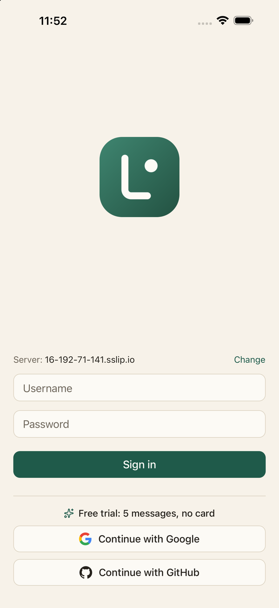
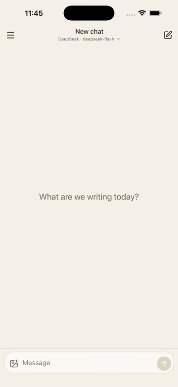

# Lumio mobile

A native iOS and Android chat app for any OpenAI-compatible API, built with Expo and React Native. It is the mobile client of [Lumio](https://github.com/Ugur22/lumio), which provides the backend and the web app.

<p align="center">
  
  &nbsp;&nbsp;
  
</p>

## What it does

- **Bring your own provider.** Chat with DeepSeek, Grok, OpenRouter or any other OpenAI-compatible endpoint, and switch provider and model from a sheet in the chat header.
- **Streaming replies** that follow along as they arrive, and keep going when you leave the app.
- **Chats** in a drawer, with rename, delete and a title taken from the first message.
- **Images:** attach photos to a message, or have the model illustrate its reply.
- **Rich replies:** Markdown, code blocks, styled notes and dialogue, rendered safely in light, dark or system theme.
- **Sign in** with a username and password, or with Google or GitHub, and a free trial to try it first.

## Run it

You need Node 22 and the [Expo Go](https://expo.dev/go) app on a phone (or an iOS/Android simulator). No Apple developer account is needed.

```sh
npm install
npx expo start
```

Scan the QR code with Expo Go. The app signs in against the deployed Lumio server by default; to use a local backend (`make dev` in the lumio repo), tap "Change" on the login screen and enter its address. Accounts are created in the web app.

Only use libraries that are bundled in Expo Go. Anything with native code of its own needs a development build.

## Checks

```sh
npm run typecheck
npm test
npm run lint
```

CI runs these plus `check:api` on every pull request. `main` only takes changes through a pull request.

## End-to-end test and demo

[Maestro](https://maestro.mobile.dev) drives the app in the iOS Simulator. The smoke test and the demo share `.maestro/subflows/signed-in.yaml` (open the app in Expo Go, sign in when needed, switch to the flash model). Boot a simulator with Expo Go, run `npx expo start` in another terminal, and set a demo account (not one with private chats):

```sh
export MAESTRO_DEMO_USER='...' MAESTRO_DEMO_PASS='...'   # single quotes: zsh expands `!`
npm run e2e                  # smoke test: sign in, send a message, wait for the reply
scripts/record-framed.sh     # films the simulator window, bezel included, while two short exchanges run (docs/demo.gif)
scripts/screenshot-framed.sh # framed screenshot of the current screen (docs/login.png; sign out first)
```

Needs `maestro` and `ffmpeg` (`brew install mobile-dev-inc/tap/maestro ffmpeg`).

The smoke test talks to the real backend, so it stays a by-hand check before a release; it does not run in CI (a simulator needs a macOS runner, and EAS or Maestro Cloud would need a build of the app, which Expo Go does not give).

### Visual check, against a stub backend

`scripts/visual-check.sh` runs the flows in `.maestro/visual` (login, provider sheet, drawer, chat) in light and dark mode and saves screenshots in `.maestro/screenshots/` (git-ignored; each run empties it). It uses a stub backend, so replies are instant and the screenshots are the same every run, and it never touches the real API. `AGENTS.md` says when it is needed (`scripts/visual-check.sh --needed` decides from the diff).

1. **Start the stub** from a checkout of the [lumio](https://github.com/Ugur22/lumio) repo: `make e2e-mobile-server`. It serves the app on `127.0.0.1:18766` with a fake upstream on `:18765` and a throwaway database that holds one account, `demo` (password `demo-visual-pass-1`). Restart it before each run that includes the drawer: it keeps its chats while it runs, and the script refuses to take the drawer against a stub that already has some.
2. **Use a simulator with Expo Go.** The script uses the booted one, else one that already has Expo Go (or the one in `VISUAL_DEVICE`). It runs `clearKeychain`, which wipes that simulator's keychain, so use a dedicated one. Turn off "Connect Hardware Keyboard" once (I/O > Keyboard in the simulator), or the keyboard screenshot shows no keyboard.
3. **Run it** from a normal terminal (a sandboxed shell cannot reach the simulator):

```sh
scripts/visual-check.sh --needed        # does this diff need it, and which flows
scripts/visual-check.sh --force         # run it anyway (or VISUAL_CHECK=force); VISUAL_CHECK=skip does nothing
scripts/visual-check.sh --flows login   # only some flows: login provider-sheet drawer chat
```

It starts Expo itself, with `EXPO_PUBLIC_LUMIO_SERVER` pointing at the stub, and stops it afterwards, so nothing else may be using port 8081. A full run is eight flow runs (four flows, light and dark), so give it several minutes. To show a fix as a before and after, copy the screenshots out before the run and put the pair side by side (`ffmpeg ... -filter_complex hstack`).

## API types

`src/api/api.gen.ts` is generated, never edited by hand. The source of truth is `openapi.json` in the lumio repo, which `make types` there regenerates and its `make check` keeps fresh. Generating from it here, with the same `openapi-typescript` version and flags as the web app, keeps both clients on one contract.

```sh
npm run sync:api                          # from lumio main
LUMIO_API_REF=v1.2.0 npm run sync:api     # from a tag or commit (or: scripts/sync-api.sh --ref <ref>)
npm run check:api                         # fails if api.gen.ts differs from lumio main
```

`check:api` needs the network, so it runs in CI (`.github/workflows/ci.yml`) and not in the Stop hook. When it fails, run `npm run sync:api`, fix any type errors it causes in `src/`, and commit the result. The backend only adds fields, because older app versions stay installed.

CI also runs `check:api` daily, so a backend API change shows up as a failed run within a day. The fix is `npm run sync:api`, then fix any type errors.
